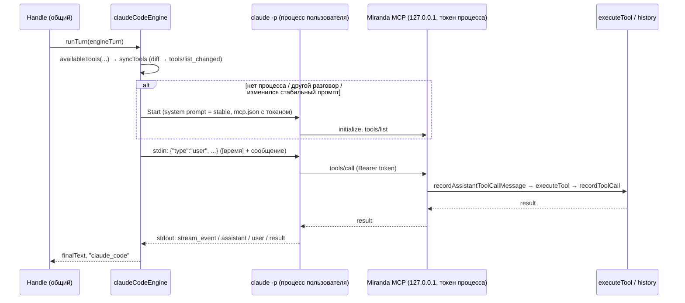

# Оркестратор `claude_code`: headless Claude Code как «мозг» хода

> Статус: прототип реализован (2026-11-08), переключается в конфиге,
> по умолчанию выключен (`agent.orchestrator: miranda`). Проверен против
> реального Claude Code CLI 2.1.286 под подпиской (pro) —
> `internal/agent_loop/claude_code_e2e_test.go`. На продакшен-сервере ещё
> не запускался.

---

## 1. Зачем

Сегодня ход Miranda крутит её собственный агентный цикл (`runAgentLoop`)
поверх роутера `llm.providers` (Gemini/Haiku/Sonnet по API-ключам). Идея:
отдать рассуждение и выбор тулов headless-процессу Claude Code
(`claude -p --input-format stream-json --output-format stream-json`), а
тулы оставить Miranda'иными.

Что это даёт:

1. **Подписка вместо токенов.** Claude Code, залогиненный через claude.ai,
   тратит окно подписки, а не API-бюджет. Окно общее с интерактивной
   работой владельца в Claude Code — это сознательно принято.
2. **Долгоживущий контекст.** Процесс держит разговор сам; Miranda шлёт
   только новое сообщение, а не всю историю на каждой итерации.
3. **Путь к «мощному» Claude Code.** Позже — отдельная сессия Claude Code
   в изолированном контейнере вместо текущей песочницы (см. §7). Сейчас из
   встроенных тулов CLI включены только веб-тулы — `WebSearch` и `WebFetch`
   (`claude_code.builtin_tools`); Bash/Read/Write и прочие **выключены**,
   песочница работает как раньше, через MCP.

## 2. Где проходит шов

Не «LLM-провайдер», а **движок хода** (`turnEngine`,
`internal/agent_loop/engine.go`). Провайдер в `miranda-llm` отвечает на
один запрос модели; Claude Code же сам крутит цикл «модель → тул → модель»,
поэтому заменяется весь `runAgentLoop`, а не один `Chat()`.

`Orchestrator.Handle` остаётся **общим** для обоих движков — всё, что
вокруг цикла, не дублируется:

| Общее (`Handle`) | Движок (`turnEngine.runTurn`) |
|---|---|
| `resolveConversation`, idle-таймаут, `TurnTracker` | рассуждение и выбор тулов |
| память, `buildSystemPrompt`, `SetSystemPrompt` | исполнение тулов — через `executeTool` |
| вложения (`processAttachments`) | запись вызовов тулов в историю (`recordAssistantToolCallMessage`/`recordToolCall`) |
| запись user/assistant сообщений, `ChatEvent` | заполнение `anomaly.Outcome` |
| end/forget/restore после ответа, fallback-ответ, `reportAnomalies` | живые текстовые чанки в hub |

`mirandaEngine` — обёртка над существующим `runAgentLoop` (поведение не
изменилось ни на байт: собирает те же два system-сообщения и тот же
список тулов). `claudeCodeEngine` — новый движок.

Выбор движка — один раз при старте: `NewOrchestrator` ставит
`mirandaEngine`; если `agent.orchestrator: claude_code`, `cmd/miranda`
вызывает `Orchestrator.EnableClaudeCode`, которая подменяет `o.engine`.
Роутер нужен в обоих режимах: саммаризация диалогов
(`summarizeConversation`) по-прежнему идёт через него.

## 3. Как работает `claude_code`



### 3.1 Процесс на пользователя (`internal/claudecode`)

Пакет `internal/claudecode` ничего не знает о Miranda — только жизненный
цикл процесса и протокол stream-json. Флаги (`buildArgs`):

- `--no-session-persistence` — CLI не пишет транскрипт на диск. Проверено:
  в `~/.claude/projects` после прогонов не появляется ничего. Источник
  правды о разговоре — только история Miranda (с redaction).
- `--tools "WebSearch,WebFetch"` — из встроенных тулов существуют только
  перечисленные в `claude_code.builtin_tools` (они же авто-разрешены в
  `--allowedTools`); пустой список выключает все. Остальное модель делает
  через Miranda MCP. Проверено на реальном CLI: `WebSearch` под подпиской
  работает. Веб-тулы — канал prompt injection в процесс, у которого есть
  тулы умного дома; это осознанный выбор, а исполнение кода по-прежнему
  только в песочнице.
- `--strict-mcp-config --setting-sources "" --disable-slash-commands` — не
  подтягиваются MCP-серверы, хуки, плагины и скиллы владельца из
  `~/.claude`. Без этого первый ход тянул ~54k токенов чужого контекста.
- `--system-prompt-file` — полностью заменяет системный промпт Claude Code
  промптом Miranda.
- `--bare` **нельзя**: он принципиально не читает OAuth/keychain, то есть
  подписку.
- Из окружения процесса вычищаются `ANTHROPIC_API_KEY`/`ANTHROPIC_AUTH_TOKEN`
  (иначе CLI молча предпочтёт API-ключ Miranda'иного anthropic-провайдера
  подписке) — `claude_code.allow_api_key_env` возвращает их.

Рабочая директория процесса — приватный temp-каталог (0700) с промптом и
`mcp.json` (в нём bearer-токен), удаляется при `Close`.

### 3.2 Когда процесс перезапускается

Ключ сессии — `userID`; процесс переиспользуется, пока совпадают
`convID` и хэш **стабильной** части системного промпта (персона, роли,
память). Перезапуск — когда:

- начался новый разговор (idle-таймаут, `end_conversation`,
  `forget_conversation`, `restore_conversation`);
- изменилась память в промпте (выбран перезапуск, а не дописывание
  памяти в сообщение: чище, и это редкое событие). Память в Miranda
  читается один раз на разговор (`conversationMemory`), так что на
  практике это совпадает с началом нового разговора — ровно как у
  `mirandaEngine`;
- процесс упал или ход был прерван (таймаут) — процесс убивается, а не
  переиспользуется в неизвестном состоянии;
- процесс простаивал `claude_code.process_idle_minutes` (по умолчанию 120).

Время жизни процесса и диалога выровнено: `process_idle_minutes` и
`memory.session_idle_timeout_minutes` по умолчанию оба 120 минут (раньше
диалог закрывался через 25). Новый диалог всё равно означает новый
процесс, так что процесс, переживающий диалог, ничего бы не дал; а
длинная сессия дольше переиспользует кэш промпта CLI.

Свежему процессу для разговора, в котором уже были ходы, первым
сообщением передаётся транскрипт из истории Miranda
(`<previous_conversation>`, результаты тулов обрезаны до 1000 символов).
Волатильная часть промпта (текущее время) идёт префиксом каждого
сообщения — системный промпт процесса фиксирован.

Ходы одного пользователя сериализуются (`lockUser`); у разных
пользователей — независимые процессы и независимые контексты.

### 3.3 Miranda MCP

Loopback HTTP-сервер (`127.0.0.1:<random>`, go-sdk streamable handler —
новых зависимостей нет). У каждой сессии свой `*mcp.Server` и свой
случайный 256-битный токен; токен однозначно определяет пользователя,
поэтому процесс не может действовать от чужого имени. Без токена — 401.

Список тулов — **ровно** `availableTools(ctx, userID, control)` этого хода.
Все правила (скрытие `speak_reply`/`stop_speech` на `ha_assist`, ленивые
группы `load_tool_group`, конфликт имён) живут в одном месте и не
повторяются. `syncTools` применяет только разницу; go-sdk рассылает
`tools/list_changed`, CLI перечитывает список. Хэндлер дополнительно
отклоняет тул, не входящий в набор этого хода.

**Гонка `tools/list_changed`** (найдена на реальном CLI): CLI перечитывает
список через ~15 мс после изменения, но применяет его асинхронно, и
сообщение, отправленное сразу, видело *старый* список (`speak_reply` на
`ha_assist`-ходу). Поэтому ход, на котором список изменился, ждёт, пока
CLI пришлёт `tools/list`, плюс `relistGrace` (200 мс; на ноутбуке
хватало 50 мс), но не дольше `relistTimeout` (2 с). Платим только при
смене набора тулов. Даже если ожидание истекло, безопасность не страдает:
снятого тула на сервере нет.

Вызовы тулов внутри сессии сериализуются (`toolMu`): CLI может вызывать
MCP параллельно, а `turnControl` и порядок «вызов → результат» в истории
рассчитаны на последовательность. id вызова — `_meta.claudecode/toolUseId`
от CLI, так что история и `llm.log` ссылаются на одно и то же.

### 3.4 История, трассировка, аномалии

- **История** пишется в точности как у `mirandaEngine`: assistant-сообщение
  с `tool_calls` → `tool`-результат → финальный ответ. Разговор можно
  продолжить, переключив оркестратор обратно. Текст, который модель пишет
  *между* вызовами тулов, в историю не попадает (он идёт по stdout, а вызов
  — по MCP; склеивать их ненадёжно) — сохраняется финальный ответ.
- **`llm.log`**: один блок на каждый вызов модели внутри CLI (граница —
  момент, когда CLI возвращает результаты тулов), `provider=claude_code`.
  Ответ в форме Anthropic Messages (`{"content":[...]}`), префикс
  `mcp__miranda__` у имён тулов снимается — поэтому `llmtrace/analyze`,
  детектор аномалий и `miranda llm-trace` работают без изменений в
  `miranda-llm`. Трейсер тот же `redact.Tracer`, что у роутера.
- **Рассуждения модели недоступны**: CLI отдаёт блоки `thinking` пустыми.
  Видно текст, вызовы тулов с аргументами, результаты, `num_turns`,
  `usage`, расчётную стоимость.
- `Outcome`: `IterationCount = num_turns`; `error_max_turns` →
  `HitIterationCap` (`claude_code.max_turns`, по умолчанию 15 — как
  `maxToolIterations`); таймаут хода → `TimedOut`.

## 4. Конфигурация

```yaml
agent:
  orchestrator: claude_code   # miranda (по умолчанию) | claude_code
  claude_code:
    binary: claude            # должен быть залогинен под тем же OS-пользователем
    model: sonnet             # по умолчанию; алиас последнего Sonnet (сейчас claude-sonnet-5-5)
    builtin_tools: [WebSearch, WebFetch]
    max_turns: 15
    process_idle_minutes: 120
    allow_api_key_env: false
    extra_args: []
```

Неизвестное значение `orchestrator` — ошибка старта, а не тихий откат на
`miranda`. При включении Miranda проверяет `claude auth status` и пишет в
лог способ входа (WARN, если не залогинен).

## 5. Проверка

- `go test ./internal/claudecode/` — протокол и жизненный цикл на
  фейковом CLI (self-exec тестового бинаря): переиспользование процесса,
  kill по таймауту, stderr при падении, удаление рабочей директории,
  флаги изоляции, очистка env.
- `go test ./internal/agent_loop/ -run ClaudeCode` — сквозной путь на
  фейковом CLI, который реально ходит в Miranda MCP по HTTP: вызов тула →
  `executeTool` → память и история; переиспользование процесса и replay
  после перезапуска; набор тулов на `ha_assist`; fallback-ответ после
  падения и восстановление; 401 на чужой токен; формат `llm.log`.
- `MIRANDA_CLAUDE_E2E=1 go test ./internal/agent_loop/ -run ClaudeCodeE2E -v`
  — то же против **реального** CLI (haiku, подписка): `remember_this`
  записывает память, контекст держится между ходами, `speak_reply`
  снимается на `ha_assist`-ходу (по `system/init` самого CLI).

Замеры спайка: холодный старт процесса + MCP ≈ 5 с, тёплый ход ≈ 1–2 с.

## 6. Компромиссы и открытые вопросы

- **Латентность голоса.** Первый ход после (пере)запуска процесса — секунды.
  Для `ha_assist` это заметно; процесс живёт до `process_idle_minutes`,
  но новый разговор (после idle-таймаута Miranda, теперь 120 минут) всегда
  начинается с холодного старта.
- **Условия подписки.** Технически работает; допустимость обслуживания
  всей семьи через личную подписку — вопрос условий Anthropic, не кода.
- **Лимиты подписки** общие с интерактивной работой; фоновые
  scheduled-задачи тоже их тратят.
- **Изображения** передаются в stream-json как image-блоки; на реальном
  CLI в этом прототипе не проверялись.
- **Эскалация роутера** (`escalation.tool_name`) в этом режиме не
  участвует — выбор модели задаёт `claude_code.model`.
- Продакшен: на сервере нужен установленный и залогиненный `claude`
  (под пользователем systemd-юнита) — `deploy`-скилл этого пока не делает.

## 7. Дальше

Песочница с полной мощью Claude Code (Bash, файлы, веб) — отдельной
сессией Claude Code в изолированном контейнере, доступной Miranda как ещё
один MCP-сервер. Этот оркестратор при этом не меняется: для него это просто
ещё один тул из `availableTools`.
